<p align="center">
  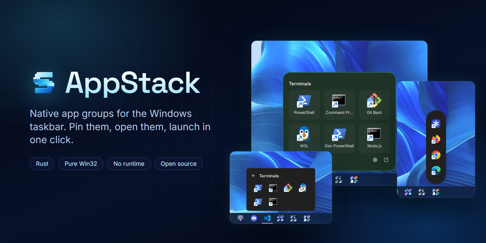
</p>

<p align="center">
  <a href="https://github.com/cristiancastineiras/AppStack/releases/latest"></a>
  <a href="https://github.com/cristiancastineiras/AppStack/releases"></a>
  
  
  <a href="LICENSE"></a>
</p>

<p align="center">
  <b>Group your apps. Pin the group to the taskbar. Open it with one click.</b><br>
  One native executable under 3 MB, written in Rust on plain Win32.<br>
  No .NET, Electron, WebView or runtime to install.
</p>

<p align="center">
  <a href="https://github.com/cristiancastineiras/AppStack/releases/latest"><b>Download</b></a> ·
  <a href="#features">Features</a> ·
  <a href="#install">Install</a> ·
  <a href="#quick-start">Quick start</a> ·
  <a href="docs/REFERENCE.md">Full reference</a>
</p>

---

<p align="center">
  <a href="img/demo.mp4">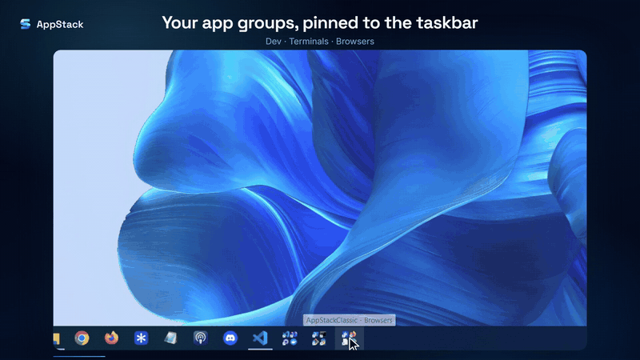</a>
  <br><sub>Real-time recording. <a href="img/demo.mp4">Watch the full demo (MP4, 1080p60)</a></sub>
</p>

## Why AppStack

The Windows taskbar fills up quickly. AppStack groups apps the way a folder on a
phone does: a **Dev** button that opens your editor, database client and Docker, a
**Browsers** button for every browser you test with, a **Terminals** folder
inside Dev. Each group is a single taskbar button and opens right above it.

|  |  |
| --- | --- |
| ⚡ **Fast** | A resident process sleeping in the Windows message loop. Reopening a pinned six-app group measured **162 ms median** from a physical taskbar click on the development PC. |
| 🪶 **Native** | Rust and plain Win32: native list views, dialogs, menus and dark mode. No framework, no browser engine, nothing to install first. |
| 🎨 **Yours** | 8 built-in popup styles, saved and shared styles, and community styles. Every size, colour, radius and shadow can be changed in a live preview. |
| 🔒 **Safe with your data** | Atomic saves with a backup copy, imports that never overwrite, and `.agz` backups that include icons and dropped shortcuts. |

## Features

### Groups that live on your taskbar

<table>
  <tr>
    <td width="58%">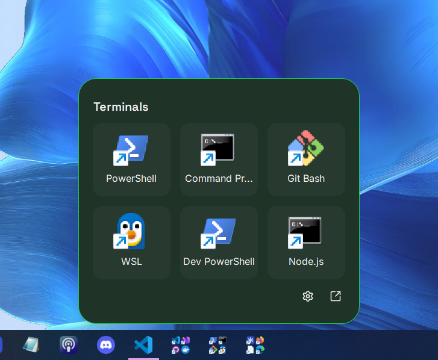</td>
    <td>
      Each group gets its own taskbar shortcut, icon and AppUserModelID, so
      Windows treats it like a separate app. Click it and the popup opens
      anchored to <i>that</i> button, on the right monitor, even if the pointer
      has already moved on.<br><br>
      Jump Lists offer <b>Edit</b> and <b>Launch all</b>, and any group can also
      have its own tray icon.
    </td>
  </tr>
</table>

<p align="center"></p>

### Subgroups open in place

<table>
  <tr>
    <td align="center">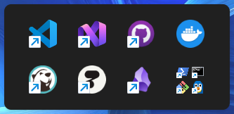<br><sub>Dev</sub></td>
    <td align="center">→</td>
    <td align="center">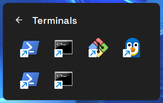<br><sub>Dev › Terminals</sub></td>
  </tr>
</table>

Put any group inside another. It slides in within the same popup, with a back
button (or <kbd>Esc</kbd> / <kbd>Backspace</kbd>). **Launch all** follows the
order on screen, includes subgroups and skips duplicates. Cycles are rejected.

### Anything you can launch

Win32 programs, Microsoft Store apps, `.lnk` and `.url` shortcuts, Steam games,
PWAs, documents and URLs, with arguments, custom icons, tooltips and
**Run as administrator**. Add them with the file picker, by typing a path or
`shell:AppsFolder\AppID`, or by dragging from Explorer or the Start menu straight
onto the manager or **onto an open popup**.

### Make it look the way you want

<p align="center">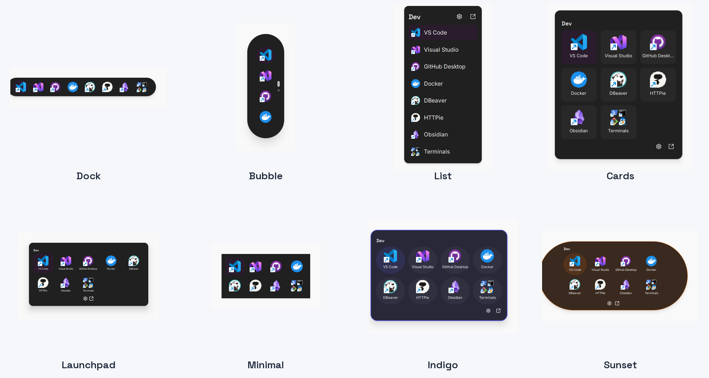</p>

Start from **Dock, Bubble, List, Cards, Launchpad, Minimal, Indigo or Sunset**, then
adjust it. Sizes use Tailwind-style tokens (`xs` to `3xl`, `rounded-full` pills
that are real pills), with icon size, columns, labels, gaps, padding, border,
accent colour and shadow. Save a look under your name, share it as a small
`.json` file, or pick one of the community styles that AppStack downloads from
this repository.

<table>
  <tr>
    <td width="62%">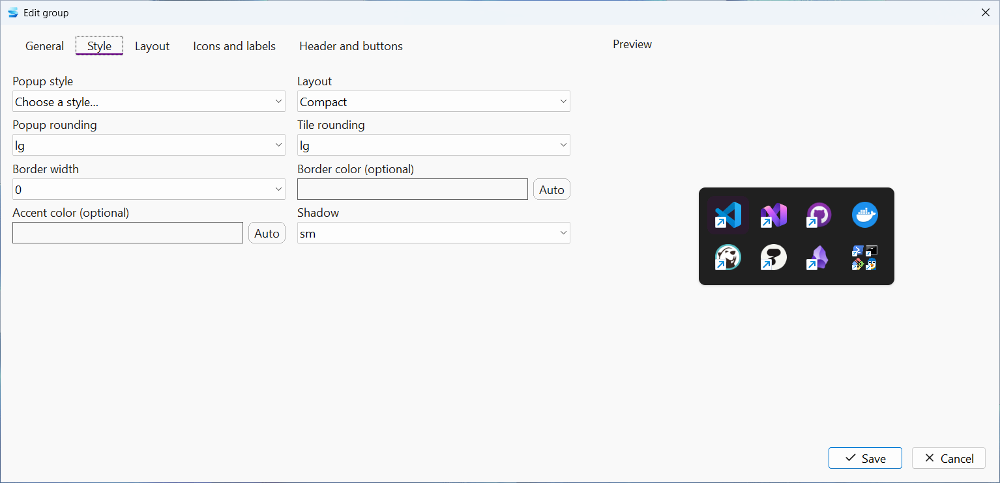</td>
    <td>
      <b>Live preview.</b> The editor has five tabs (General, Style, Layout, Icons
      and labels, Header and buttons) and a preview that redraws as you change
      anything. Nothing is written until you press <b>Save</b>; <b>Cancel</b>
      leaves your configuration untouched.
    </td>
  </tr>
</table>

<details>
<summary><b>More screenshots</b></summary>
<br>

| Manager | Preferences |
| --- | --- |
| 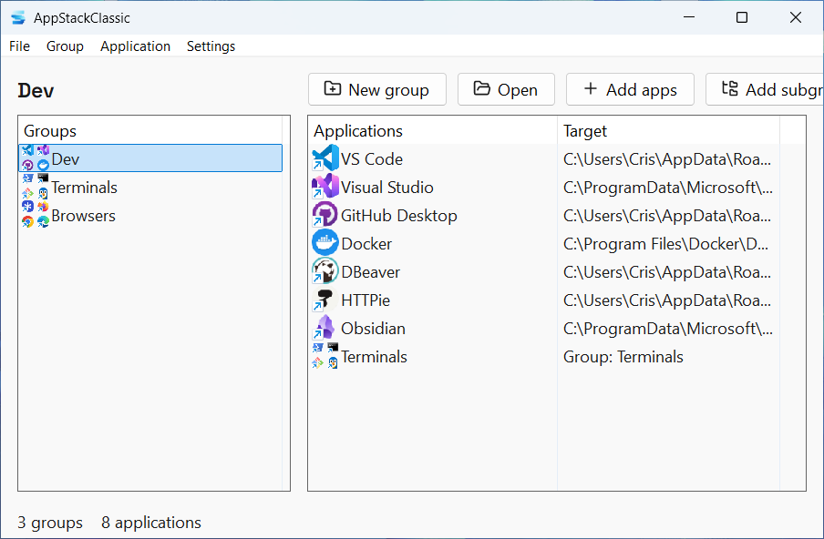 | 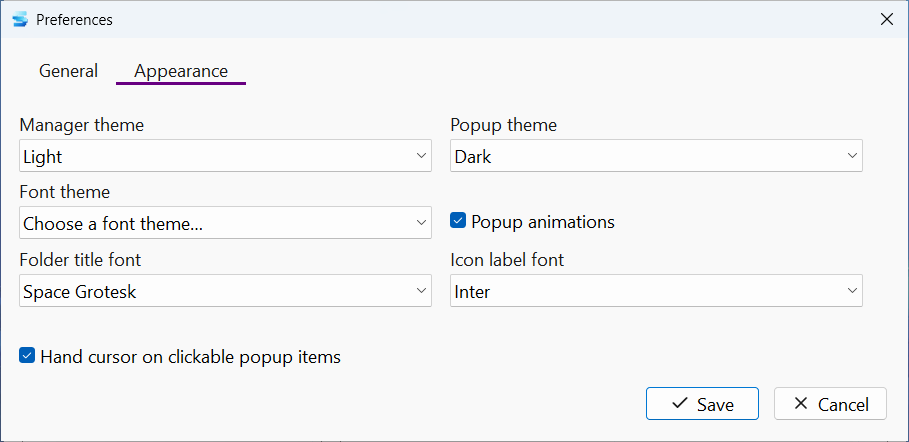 |
| **Popup style menu** | **Popup context menu** |
| 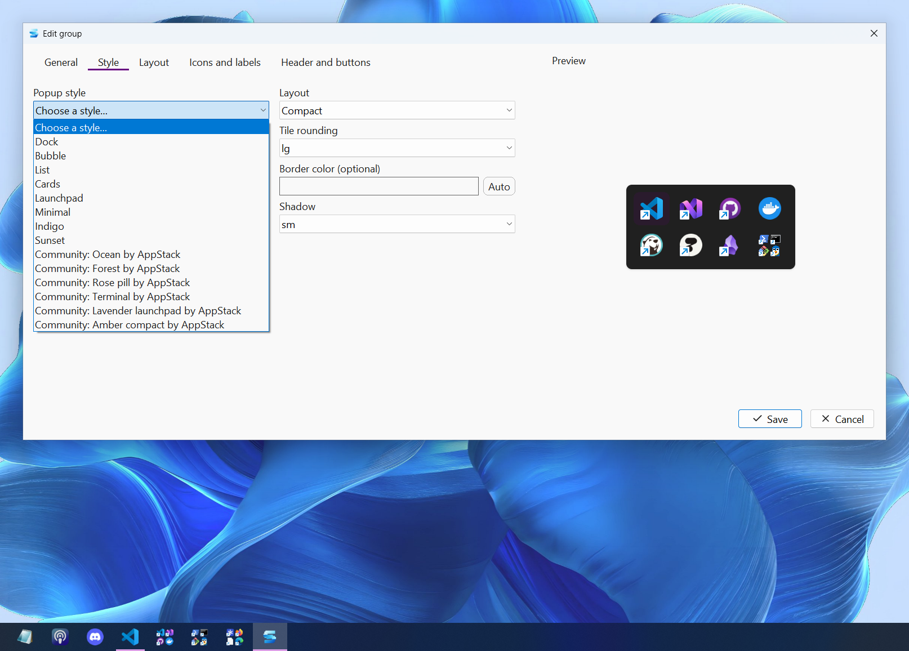 | 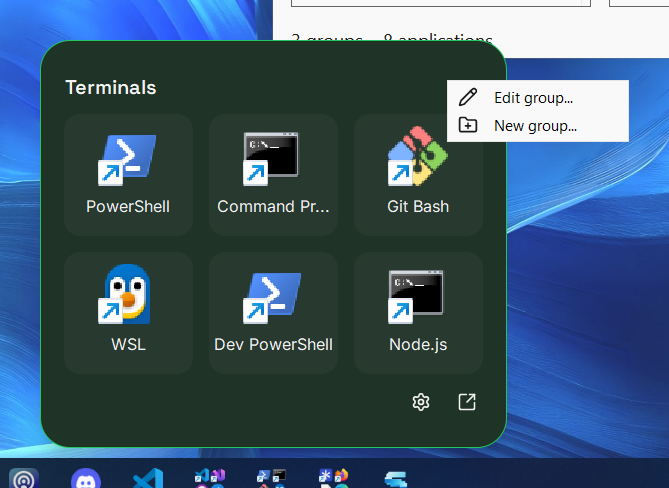 |
| **Layout tab** | **Icons and labels tab** |
| 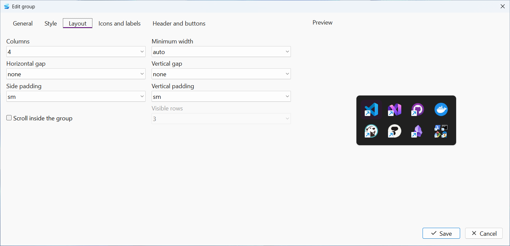 | 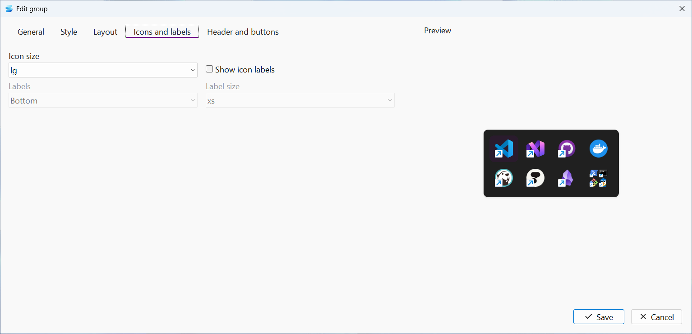 |
| **Bubble group** | **Group menu** |
| 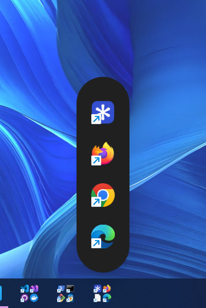 | 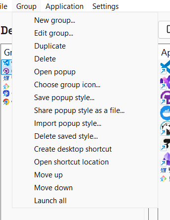 |

</details>

### Details that add up

- **Light, dark and high contrast**, with separate themes for the manager and the popups.
- **Fonts**: Space Grotesk and Inter are built in, with font pairs that ship with Windows one click away.
- **Popup animations** and a **hand cursor** over clickable items, both optional.
- **Long groups scroll by pages**, like the Windows 11 Start menu, with page dots.
- **Keyboard first**: arrows, <kbd>Enter</kbd> and <kbd>Esc</kbd> in popups; <kbd>F2</kbd>, <kbd>Delete</kbd> and <kbd>Ctrl</kbd>+<kbd>N</kbd> in the manager.
- **Coming from TaskbarGroups?** Import its configuration folder directly.
- **Automatic updates** from GitHub releases, always asking first. They can be turned off.

## Install

Download from the [latest release](https://github.com/cristiancastineiras/AppStack/releases/latest):

| File | What it is |
| --- | --- |
| `AppStackClassic-setup.exe` | Per-user installer. No administrator rights, English and Spanish, uninstalls cleanly from **Installed apps**. |
| `AppStackClassic-portable.exe` | The whole program in one file. Run it from any folder or USB drive; it keeps its data in a `config` folder beside itself. |

Requires Windows 10 or 11, x64.

## Quick start

1. **Create a group.** Open AppStack and press **New group** (<kbd>Ctrl</kbd>+<kbd>N</kbd>). Name it, for example `Dev`.
2. **Add apps.** Press **Add apps**, or drag programs and shortcuts from Explorer or the Start menu into the list.
3. **Pin it.** Choose **Group › Open shortcut location** and drag the shortcut onto the taskbar.
4. **Style it.** Right-click the popup › **Edit group**, open the **Style** tab and pick a popup style.

To nest groups, select a group and press **Add subgroup**.

## Command line

```powershell
AppStackClassic.exe --group "Dev"          # open a group's popup
AppStackClassic.exe --launch-all "Dev"     # launch every app in a group
AppStackClassic.exe --edit "Dev"           # open the editor
AppStackClassic.exe --portable             # keep data beside the executable
```

Names work, IDs are unambiguous. See the [command reference](docs/REFERENCE.md#commands) for the rest.

## Build from source

Windows 10/11 x64, Rust 1.85+ with the MSVC toolchain, and Visual Studio Build
Tools with the *Desktop development with C++* workload.

```powershell
git clone https://github.com/cristiancastineiras/AppStack.git
cd AppStack
.\scripts\build.ps1
.\target\release\AppStackClassic.exe
```

The executable links the CRT statically, so it needs no Visual C++ redistributable.

## Documentation

- [Technical reference](docs/REFERENCE.md): every feature, storage, performance measurements, verification and code layout.
- [CHANGELOG](CHANGELOG.md) · [Contributing](CONTRIBUTING.md) · [Security](SECURITY.md) · [Accessibility](ACCESSIBILITY.md) · [Code of conduct](CODE_OF_CONDUCT.md)

## License

[MIT](LICENSE). Bundled fonts and icons are listed in [THIRD-PARTY-NOTICES.md](THIRD-PARTY-NOTICES.md).
